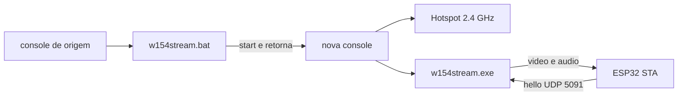

# Launch the API on a 2.4 GHz hotspot

The API stays a normal Windows process. A container cannot own the radio, and Docker Desktop cannot sit on the hotspot LAN. Release builds live in the project `bin\Release` folders. The launch bats only run those exes.

## `build.bat`

Root script. `dotnet build -c Release --nologo -v q` into the folders the launchers already use:

- `--converter` builds [W154Convert/W154Convert.csproj](W154Convert/W154Convert.csproj) to `W154Convert\bin\Release\net10.0\w154.exe`
- `--api` builds [W154Stream/W154Stream.csproj](W154Stream/W154Stream.csproj) to `W154Stream\bin\Release\net10.0\w154stream.exe`
- No flag, or both flags, builds the two projects. An unknown flag exits 1.
- Stop on the first failed build.

[w154convert.bat](w154convert.bat) loses its `dotnet build`. It runs the Release exe and forwards `%*`. If `w154.exe` is missing, it prints that `build.bat --converter` has to be run first and exits 1.

## `w154stream.bat`

Thin launcher at the repo root. It `start`s a new console titled `W154Stream` running `powershell -NoProfile -ExecutionPolicy Bypass -File w154stream.ps1`, forwards `%*`, and exits. The console where the bat was launched returns immediately. The ps1 is the body, because WinRT tethering and a `finally` that stops the hotspot do not fit in cmd.

The new console keeps the caller's working directory, so `--dir` still defaults to that folder.

## `w154stream.ps1`

Runs only in the new console. If that process is not admin, it re-launches itself with `-Verb RunAs` and the same working directory, then the non-admin window exits. UAC once. One elevated window remains, and that window is the API console. The caller's console is not part of this.

Read [firmware/w154/main/wifi_secrets.h](firmware/w154/main/wifi_secrets.h) (gitignored). If it is missing, exit and print the `copy` from [docs/firmware-w154.md](docs/firmware-w154.md). Parse `WIFI_SSID`, `WIFI_PASS`, and `HOST_IP`. Refuse a passphrase shorter than 8 characters, because the firmware asks for `WIFI_AUTH_WPA2_PSK` in [firmware/w154/main/net.c](firmware/w154/main/net.c).

Hotspot, in order:

- Fail with the `netsh wlan show drivers` line when hosted network is not supported.
- Take the internet connection profile (the 5 GHz link) and `NetworkOperatorTetheringManager.CreateFromConnectionProfile`.
- Stop tethering if it is already on, so the new SSID and band apply.
- `ConfigureAccessPointAsync`: SSID and passphrase from the header, WPA2, `TetheringWiFiBand.TwoPointFourGigahertz`. If that band member is missing, exit. Do not start an AP and hope it is 2.4 GHz.
- `StartTetheringAsync` and require a success status.
- Read `ScopeAddress` under `HKLM\SYSTEM\CurrentControlSet\Services\SharedAccess\Parameters` and wait until that IPv4 address is assigned. Compare it to `HOST_IP`. On mismatch, print both and exit before the API starts. The usual value is `192.168.137.1`.
- Replace a firewall rule named `W154Stream UDP` so inbound UDP on the hello port is allowed on every profile. Default port 5091; use `--hello` from the forwarded args when present. HTTP stays on localhost and needs no rule.

Run the existing `W154Stream\bin\Release\net10.0\w154stream.exe` in that same new window, with the forwarded args. If the exe is missing, print that `build.bat --api` has to be run first and exit 1. Do not build on launch. `--dir` still defaults to the current directory inside [W154Stream/Program.cs](W154Stream/Program.cs). Print SSID, gateway, and `http://localhost:5090/files` before the process blocks. Do not print the passphrase. Do not `POST /play`.

Closing that window, or Ctrl+C in it, calls `StopTetheringAsync` so the radio does not stay up. The caller's console is already free and is not involved.

No change to the pump. It already binds `IPAddress.Any` in [W154Stream/Pump.cs](W154Stream/Pump.cs) and answers the hello with unicast.

## Docs

- [README.md](README.md): `build.bat` produces the two Release exes. `w154convert.bat` and `w154stream.bat` run them. `dotnet run` stays as the manual form.
- [docs/api-w154.md](docs/api-w154.md): the bat publishes the SSID from `wifi_secrets.h` on 2.4 GHz and checks the live ICS address against `HOST_IP`.
- [docs/firmware-w154.md](docs/firmware-w154.md): `HOST_IP` is that gateway. The flashed SSID and passphrase are what the bat configures.
- [firmware/w154/main/wifi_secrets.example.h](firmware/w154/main/wifi_secrets.example.h): `HOST_IP` becomes `192.168.137.1`.
