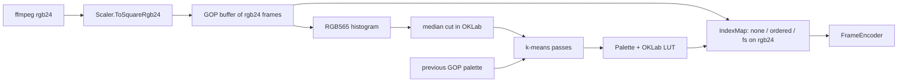

# Better W154 palette generation

All work stays inside `W154Convert` (no `PackageReference`, AOT-safe, no reflection or `Regex`). `W154Format` and the file format stay as they are. Messages and docs stay in pt-BR, and identifiers and flags stay in English.

## Current problems

- [W154Convert/Picture/Scaler.cs](W154Convert/Picture/Scaler.cs) cuts frames down to RGB565 before quantizing, so Floyd-Steinberg diffuses error from pixels that already lost their 24-bit precision.
- [W154Convert/Picture/Quantizer.cs](W154Convert/Picture/Quantizer.cs) `SplitScore` ignores population, the split point is the population median, and the channel weights don't match `BuildLut` (8/4/8 versus 2/4/3).
- Each GOP palette is built independently, so colors can shift at every keyframe.
- Floyd-Steinberg noise changes from frame to frame, which marks bands dirty and inflates deltas.

## New pipeline

## Changes

**1. New file `W154Convert/Picture/ColorSpace.cs`**
- `Expand565(ushort, out r, out g, out b)` expands RGB565 to 8 bits with bit replication (`r5 << 3 | r5 >> 2`), so pure white comes out as 255. The shared `Rgb565.Unpack` in `W154Format` stays untouched.
- A lazily built static table `float[65536 * 3]` maps RGB565 to OKLab. It converts sRGB to linear, then to OKLab, using `MathF.Cbrt`.
- `Distance(int a, int b)` is the squared OKLab distance between two table entries.

**2. [W154Convert/Picture/Scaler.cs](W154Convert/Picture/Scaler.cs)**
- Add `ToSquareRgb24(...)`, which returns the 240x240x3 buffer it already computes internally. `ToRgb565` calls it and packs the result, so the existing `CheckFit` tests keep passing.

**3. [W154Convert/Picture/Quantizer.cs](W154Convert/Picture/Quantizer.cs)**: `Build(IReadOnlyList<byte[]> rgbFrames, bool reserveBlack, Palette? previous)`
- Keep the RGB565 histogram and the exact path (256 colors or fewer, used as-is).
- Median cut in OKLab:
  - Pick the box with the largest weighted squared error, which grows with population.
  - Split it along its highest-variance axis at the error-minimizing point.
- Refine with 4 k-means passes over the histogram bins, weighted by count, with centroids kept in OKLab. An empty cluster gets reseeded with the worst-error bin. With `contain`, the black slot stays pinned in slot 0.
- Previous-GOP seed: also run the k-means passes starting from `previous.Entries`, and keep that result unless its error is more than 10% worse than the result from the median-cut start. A scene cut usually exceeds that margin, so cuts still get a fresh palette.
- Snap each centroid to the closest member bin's RGB565 value. Members don't overlap, so entries stay unique, as the format requires.
- `BuildLut` uses OKLab distance. Ties go to the lowest index, so output is deterministic.

**4. [W154Convert/Picture/IndexMap.cs](W154Convert/Picture/IndexMap.cs)**: `Map(byte[] rgb24, Palette, DitherMode)`
- `None`: `lut[Pack(r,g,b)]`.
- `Ordered`: add a Bayer 8x8 offset to each channel (fixed strength constant, about ±12 per channel), then look up. The offset depends only on the pixel position, so a static scene keeps the same indices.
- `Fs`: Floyd-Steinberg from the 24-bit source, scanning in alternating directions. The palette color is expanded with `ColorSpace.Expand565`, and the accumulated error is clamped.

**5. [W154Convert/Convert/Converter.cs](W154Convert/Convert/Converter.cs)**
- Add `enum DitherMode { None, Ordered, Fs }`. `ConvertRequest.Dither` changes from `bool` to `DitherMode`.
- The GOP buffer holds rgb24 frames (`byte[]`, 172800 bytes each; a 60 fps GOP is about 10 MB).
- Pass the previous palette into `Quantizer.Build` across `Flush` calls.
- `EncodeFrames` keeps taking `ushort[]` frames (the selftests depend on that), expands them with `ColorSpace.Expand565`, and takes `DitherMode dither`.

**6. [W154Convert/Program.cs](W154Convert/Program.cs)**
- `--dither none|ordered|fs`, default `none`. A bare `--dither` (no value, or followed by another `--flag`) still means `fs`, and so does `--dither=fs`.
- Any other value fails with `dither deve ser none, ordered ou fs.`
- `RejectUnknown` and `FlagValue` handle the optional value.
- The prompt becomes `Dither (none/ordered/fs) [none]`.
- Update the help text, including the dither line and examples.

**7. [W154Convert/SelfTest.cs](W154Convert/SelfTest.cs)**: new checks
- OKLab: black has L = 0, white has L close to 1, and `Expand565(0xFFFF)` gives 255.
- Lossless path: a frame with 200 or fewer colors maps back to the exact RGB565 values.
- 24-bit gradient (more than 256 colors): 256 unique entries and average OKLab error below a fixed bound.
- `contain` still writes `palette[0] = 0` (existing check, updated to the new signature).
- Ordered dither: two identical frames make the second body an empty delta (12 bytes).
- FS on a flat color already in the palette gives a single index with no noise.
- Seeding: two GOPs with identical content produce identical palettes.

**8. Docs**
- [docs/conversor-w154.md](docs/conversor-w154.md):
  - Rewrite the palette paragraph in the GOP section (OKLab, median cut plus k-means, previous-GOP seed).
  - Rewrite the dither paragraph to describe the three modes and the advice that `ordered` keeps deltas small while `fs` dirties bands.
  - Update the usage section.
- Check whether [README.md](README.md) mentions `--dither` and align it if so.
- Add one line to [.cursor/rules/w154-converter.mdc](.cursor/rules/w154-converter.mdc) on `--dither none|ordered|fs` and the OKLab quantizer.

## Verification

- `dotnet build` and `w154 selftest`.
- Convert a sample clip with each dither mode and compare the "pior segundo" (worst second) and "média" (average) Mbit/s lines against the current build. Inspect the result visually with the VLC plugin.
- Commit message in pt-BR, for example `feat(conversor): gerar paleta em OKLab com k-means e dither ordenado`.

## Suggestions for later

- `--palette-passes` to trade speed for quality, if conversion gets slow on long clips.
- Detect scene cuts and force an early keyframe there. This needs a format and rule discussion, because keyframes are currently fixed at multiples of `gop`.