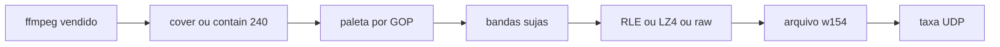

# Conversor interativo `.w154`

Repo vazio em [streamESPer](f:\Repos\jpgma\streamESPer). O contrato está em [12-w154-video.md](f:\Repos\jpgma\esp32-s3\boards\waveshare-touch-lcd-154\docs\guides\12-w154-video.md): arquivo de índices 240×240, paleta RGB565 por GOP, bandas de 8 linhas, RLE ou LZ4, CRC32 zlib. O CLI não monta datagramas UDP; só calcula a taxa como o guia manda.

## Forma do programa

Solution `StreamESPer.sln` na raiz do repo. O conversor é o primeiro projeto, em [W154Convert/W154Convert.csproj](W154Convert/W154Convert.csproj), ao lado da solution — sem pasta `src`. A API de streaming entra depois como outro projeto da mesma solution; este passo não cria esse projeto.

`net10.0`, `AssemblyName` `w154`, `Nullable`, `ImplicitUsings`, `InvariantGlobalization`, `PublishAot` só no publish. Zero `PackageReference`. `dotnet run --project W154Convert` continua JIT; `dotnet publish W154Convert -c Release` gera o exe nativo.

Identificadores, flags e nomes de tipo ficam em inglês (`frame_us`, `band_mask`, `body_bytes`, `keyframe`, `gop`, `cover`, `contain`). Texto de prompt, erro, progresso e documentação em pt-BR.

## ffmpeg no repositório

Build **LGPL win-x64** pinada (BtbN), pasta inteira `bin/` em `tools/ffmpeg/win-x64/`, mais `LICENSE` e um aviso curto com URL e versão exatas. O processo C# só chama o executável; o código do conversor não vira obra derivada do ffmpeg. Decoders comuns (H.264, HEVC, AV1, VP9) cabem na build LGPL.

Resolução, nesta ordem: ao lado do exe publicado, subindo diretórios até `tools/ffmpeg/win-x64/ffmpeg.exe`, depois `PATH`.

Invocação: `ffmpeg -hide_banner -loglevel error -i <arquivo> -map 0:v:0 -vf fps=<N> -f rawvideo -pix_fmt rgb24 pipe:1`. O filtro `fps` entrega cadência inteira; áudio é ignorado. Geometria fica em C#, para o selftest não depender de vídeo.

## Pipeline

- `frame_us = (1000000 + fps / 2) / fps`. Aceita só fps inteiro 1..60 (`frame_us` de 16667 a 1000000). 24 → 41667, 30 → 33333.
- `gop = max(1, (1000000 + frame_us / 2) / frame_us)` — um keyframe por segundo.
- Cada frame: RGB24 nativo → **cover** (crop central quadrado, padrão) ou **contain** (cabe em 240 e pad com índice 0; `palette[0]` = RGB565 0). Downscale por média de área; upscale bilinear.
- RGB565: `(R >> 3) << 11 | (G >> 2) << 5 | (B >> 3)`, little-endian, igual ao `rgb565()` do hello. Sem o invert do painel.
- Um GOP na RAM (240×240 RGB565 × ~24..60 frames). Histograma de 65536 bins. Se couber em 256 cores únicas, a paleta é essa. Senão, median cut no histograma, média do box estalada de volta num RGB565 do box, sem slot repetido. LUT de 64 KiB do RGB565 mais próximo (distância em 8 bit, pesos 2, 4, 3).
- Dither desligado por padrão. Se pedido: Floyd–Steinberg na hora de mapear, contra a paleta do GOP. Dither suja banda; o rate check é quem recusa.
- Frame 0 e todo índice múltiplo de `gop`: keyframe (`flags` bits 0 e 1, 30 bandas, `band_mask = 0x3FFFFFFF`, paleta). Delta sem paleta; bit `i` só se os 1920 índices mudaram. Delta vazio é o still frame legal (`band_count = 0`).
- Por banda: RLE e um bloco LZ4 (sem frame header). Descarta resultado com `comp_bytes >= 1920`. Menor ganha; empate fica RLE; senão raw 1920. Pad de zeros até múltiplo de 4.
- CRC32 PNG/zlib do body antes do campo. `body_bytes` máximo 58244.
- Escrita em duas etapas: bodies num temp (o `frame_count` só existe no EOF), depois header de 32 bytes, tabela de offsets `u32` e os bodies. Offsets crescentes; o primeiro é `32 + frame_count * 4`.

## CLI

Sem args obrigatórios, pergunta em pt-BR: arquivo, saída (default troca a extensão para `.w154`), fps (default 24), `cover`/`contain`, dither sim/não.

Flags em inglês, para pular o prompt: `--input`, `--output`, `--fps`, `--fit`, `--dither`, `--allow-over-budget`, `--help`. Subcomando `selftest` não chama ffmpeg.

Depois de gravar, relê o arquivo e aplica a lista “a reader accepts a file when” do guia (magic, offsets, CRC, keyframes, decode das bandas, delta igual ao frame anterior). Falha de verificação apaga o `.w154` e sai 1.

Rate check por body: `frags = ceil(body_bytes / 1456)`, `udp_bytes = body_bytes + 16 * frags`. Soma por segundo alinhado e a média. Imprime média, pior segundo e a faixa (≤16 confortável, 16..21 intermitente, >21 estoura). **Sempre grava.** Exit 0 se o pior segundo ≤ 16; exit 2 se passar, a menos que `--allow-over-budget`.

## Selftest (sem NuGet)

Vetores no próprio exe: CRC de `123456789` = `0xCBF43926`; RLE do guia (1920 vezes o índice 7 → quinze pares `FF 07`, `comp_bytes = 30`); roundtrip LZ4 de faixa plana, ruído e bloco que não comprime; keyframe raw com body 58244 → 41 fragmentos → 58900 bytes UDP; arquivo sintético de dois GOPs com uma banda suja e um still, passando no leitor.

## Documentação e regra

- [README.md](README.md) curto, pt-BR: build, publish AOT, onde está o ffmpeg, exemplos interativo e com flags.
- [docs/conversor-w154.md](docs/conversor-w154.md), pt-BR: picture, GOP, keyframe, delta, codecs, rate check. Nomes de campo e de estrutura permanecem em inglês.
- Regra só ao editar o conversor, não `alwaysApply` (a solution ainda ganha a API): [.cursor/rules/w154-converter.mdc](.cursor/rules/w154-converter.mdc), globs `W154Convert/**/*.cs`, `docs/**/*.md`. A regra trava: sem NuGet, AOT, contrato do guia 12, desempate RLE, paleta por GOP, textos pt-BR, flags em inglês, e atualizar o doc e o selftest se o formato mudar.
