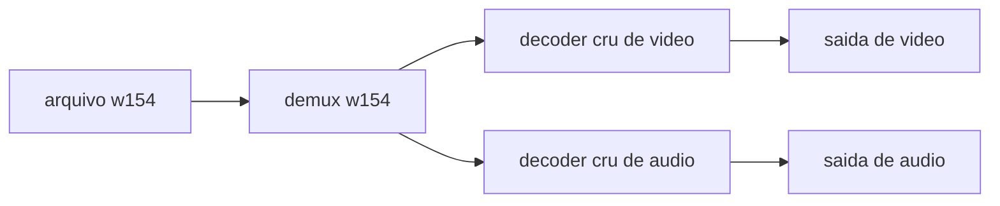

# Plugin VLC para `.w154`

Um único módulo **demux** (não um codec separado) para o VLC **3.0.24** já instalado em `f:\Program Files\VideoLAN\VLC`. O protocolo UDP fica de fora. O PCM, quando o arquivo traz, toca pelo decoder cru de áudio do VLC.

O demux lê o container, guarda o quadro indexado e a paleta, e entrega cada quadro já expandido como `VLC_CODEC_RGB16` (`RV16`, RGB565 little-endian). Com `audio_offset != 0`, abre um segundo elementary stream `VLC_CODEC_S16L` (s16le, 1 canal, a taxa do arquivo). Os dois decoders crus do VLC fazem o resto. 240×240 torna o quadro expandido barato (115200 bytes), e o estado do delta fica num lugar só.



`audio_offset == 0` não cria o stream de áudio. Um `.w154` só de vídeo continua válido.

## O que o player faz

Contrato em [docs/formato-w154.md](docs/formato-w154.md). A lógica de vídeo espelha `DecodeFrame` em [W154Convert/Format/W154File.cs](W154Convert/Format/W154File.cs): magic `W154`, `version` 1, 240×240, `frame_us` em 16667..1000000, offsets crescentes, `body_bytes` em 12..58244, CRC32 zlib, keyframe quando `index % gop == 0` com `gop = max(1, (1000000 + frame_us / 2) / frame_us)`. O word do offset 28 é `audio_offset`. O `flags` do header continua 0.

- Keyframe substitui os 57600 índices e a paleta. Delta copia só as bands com bit ligado.
- Cada índice vira o `u16` RGB565 da paleta, copiado direto para o bloco. Sem a inversão do painel: isso é do LCD, e o monitor deve mostrar a cor que o conversor quantizou.
- Delta vazio ainda gera um quadro igual. No painel a GRAM fica quieta; no VLC o relógio precisa do quadro, senão a duração encolhe e o áudio descola.
- Seek cai no keyframe anterior (`index - index % gop`), decodifica o vídeo em silêncio até o quadro pedido e só então envia. O preroll não manda áudio. O PTS do quadro `n` é `VLC_TS_0 + n * frame_us`. A duração do demux é `frame_count * frame_us`.
- CRC, codec ou band inválidos param o demux com erro. A checagem “bit ligado significa diferença real” fica no conversor; o player não a repete.

Áudio, seção [Áudio](docs/formato-w154.md) do formato. `audio_offset` diferente de 0 é o primeiro byte depois do último body. O bloco é 16 bytes mais o PCM:

```text
u32 pcm_bytes          > 0 e par
u32 sample_rate        16000, 24000 ou 48000
u16 channels           1
u16 sample_format      0 = s16le
u32 crc32              PNG/zlib só do PCM
s16le pcm[pcm_bytes]
```

`pcm_bytes` tem que bater com a duração do vídeo:

```text
timeline_us  = frame_count * frame_us
sample_count = (timeline_us * sample_rate + 500000) / 1000000
pcm_bytes    = sample_count * 2
```

Taxa fora dessas três, `channels != 1`, `sample_format != 0`, `pcm_bytes` ímpar ou 0, CRC errado, folga antes do bloco ou byte depois do PCM recusam o arquivo. O CRC do body de vídeo não cobre o PCM. O `Open` percorre o PCM uma vez para o CRC e não o segura na RAM; a reprodução lê de novo do arquivo.

A amostra `i` está em `(i * 1000000) / sample_rate` microssegundos, o mesmo relógio do quadro `n`. A cada quadro o demux manda o PCM cujo instante cai em `[n * frame_us, (n+1) * frame_us)`, com PTS `VLC_TS_0 + i * 1000000 / sample_rate`. A conta cabe em `uint64`. O quadro seguinte esvazia o que a fórmula de arredondamento deixou no fim. O VLC alinha os dois streams por esses PTS. A folga de 20–40 ms, o PA do GPIO7 e o ring do ES8311 são do firmware, não deste plugin.

No seek para o quadro `n`, o cursor de áudio vai para `i = (n * frame_us * sample_rate) / 1000000`.

RLE e LZ4 são só o decode, portados de [W154Convert/Codec/BandRle.cs](W154Convert/Codec/BandRle.cs) `TryDecode` e [W154Convert/Codec/Lz4Block.cs](W154Convert/Codec/Lz4Block.cs) `TryDecode`. Sem encoder, sem NuGet, sem liblz4.

## Código

Pasta nova [vlc-w154/](vlc-w154/), fora do `StreamESPer.sln`.

- `decode.h` / `decode.c` — sem header do VLC, para o teste linkar sozinho. Inclui o parser do bloco de áudio e o CRC do PCM.
- `demux.c` — módulo 3.0: capability `demux` score 50, atalho `w154`, `CAT_INPUT` / `SUBCAT_INPUT_DEMUX`. `Open` espia os 4 bytes `W154` e devolve `VLC_EGENERIC` nos outros arquivos. Vídeo: `VLC_CODEC_RGB16`. Áudio, só se houver bloco: `VLC_CODEC_S16L`, `i_channels = 1`, `i_rate` do arquivo, 16 bits, block align 2, canal físico center (`include/vlc_es.h` da tag 3.0.24). `pf_control` cobre length, time, position, set time e set position, e os dois repositionam o cursor de áudio.
- `decode_test.c` — CRC de `123456789` = `0xCBF43926`, RLE de 1920 índices 7 (quinze pares `FF 07`), um bloco LZ4 só de literais, um `.w154` só de vídeo (`audio_offset` 0) e outro com PCM s16le conhecido. O de dois quadros a 24 fps (`frame_us` 41667) e 48000 Hz tem `sample_count = (83334 * 48000 + 500000) / 1000000`. O teste recusa 22050, `channels = 2` e `pcm_bytes` ímpar.

Licença do plugin: **LGPL-2.1-or-later**, a mesma do `libvlccore`. Cabeçalho SPDX nos `.c`. Antes de `vlc_module_end()`, exportar essa licença com as macros de [vlc_plugin.h](https://github.com/videolan/vlc/blob/3.0.24/include/vlc_plugin.h) (`MODULE_SYMBOL` é `3_0_0f`, então a DLL exporta `vlc_entry__3_0_0f`). Não copiar código GPL de módulos do VLC. O conversor .NET não muda de licença.

## Build e instalação

[vlc-w154/build.ps1](vlc-w154/build.ps1), mensagens em pt-BR. Cache gitignored em `vlc-w154/.cache/`:

- MinGW-w64 x86_64 UCRT (WinLibs, zip pinado, sem clang). O VLC oficial é MinGW; MSVC quebra o layout de `demux_t`.
- Fonte `vlc-3.0.24.tar.xz` só pela árvore `include/`. `vlc_config.h` dessa tag não exige `config.h` gerado.
- `gendef` + `dlltool` em `f:\Program Files\VideoLAN\VLC\libvlccore.dll` para gerar o import lib.

Compilar o teste e rodá-lo. Compilar `libw154_plugin.dll` com `-D__PLUGIN__ -DMODULE_STRING=\"w154\" -static-libgcc` e linkar só `libvlccore`. Copiar para `plugins\demux` e rodar `vlc-cache-gen.exe` nessa pasta de plugins (o cache `plugins.dat` ignora DLL nova se não for regenerado). O caminho do VLC é parâmetro, com default `f:\Program Files\VideoLAN\VLC`. Sem permissão de escrita em Program Files, o script deixa a DLL em `vlc-w154/out/` e imprime o comando para repetir elevado.

Parágrafo curto no [README.md](README.md): abrir um `.w154` no VLC, ou `vlc --demux w154 video.w154`. Sem associação de extensão no registro do Windows.

## Verificação

O teste C cobre o decode de vídeo, o arquivo sem áudio e o bloco PCM. Em seguida, o próprio teste grava o `.w154` com PCM e o script abre com `vlc.exe --intf dummy --aout=adummy --play-and-exit`. Sucesso é o processo sair 0 e o log citar o demux `w154`, sem “no suitable demux”. `adummy` evita depender da placa de som.
