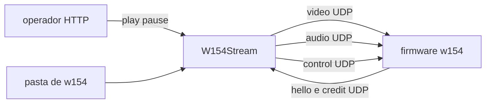

# Stream `.w154` para o painel

O arquivo não muda. O contrato de vídeo e de PCM em [docs/formato-w154.md](docs/formato-w154.md) (seção No ar) continua o que vai no datagrama. Hello, crédito e pause são um protocolo de sessão à parte, documentado em pt-BR, com os termos `frame`, `struct`, `keyframe`, `band`, `palette` e `socket` em inglês.

## Decisões

- Tudo novo neste repo. O `wiftp` no repo do painel não é editado. Os pinos usados (ST7789, I2C, ES8311, PA GPIO7) entram num header local, copiados de `board.h` daquele repo.
- A Minimal API é só controle. O device “conecta” com um datagram de hello; a API responde em unicast. Sem TCP no caminho do `frame`.
- Playback começa no primeiro keyframe completo. Não há preroll de vídeo. O PA sobe ~35 ms antes da primeira amostra, e o ring de I2S fica em ~50–100 ms na DRAM interna — isso é o atraso mínimo do alto-falante, não uma espera para encher a PSRAM.
- Vídeo segue na velocidade do `SendTo`, freado só pelo crédito do ring. Se a rede é mais rápida que o `frame_us`, o excedente acumula na PSRAM. Com o vídeo pausado (operador ou underrun), o ring continua enchendo até lotar.
- Áudio não usa esse ring. O guia limita o PCM à DRAM interna. A API mantém o PCM ~80 ms à frente do playhead que o device reporta, não à frente do ring de vídeo.
- Um device por vez. Hello novo substitui o anterior. Um arquivo por `POST /play`. Toca uma vez e segura o último `frame`. Sem mDNS, sem auth, sem playlist.
- O device acha o host por `HOST_IP` em `wifi_secrets.h`. A pasta vem de `--dir` na API.

## Lib `W154Format`

Class library `net10.0`, `IsAotCompatible`, `InvariantGlobalization`, sem `PackageReference`. Entra na [StreamESPer.sln](StreamESPer.sln).

Move, e torna público o que o conversor e a API usam:

- [W154Convert/Picture/PictureContract.cs](W154Convert/Picture/PictureContract.cs), [Rgb565.cs](W154Convert/Picture/Rgb565.cs)
- [W154Convert/Codec/](W154Convert/Codec/) (`Crc32`, `BandRle`, `Lz4Block`, `BandCodec`)
- [W154Convert/Format/](W154Convert/Format/) (`W154File`, `FrameEncoder`, `W154Draft`, `AudioPcm`, `RateCheck`)
- [W154Convert/W154Exception.cs](W154Convert/W154Exception.cs)

Ficam no conversor: CLI, ffmpeg, quantizer, scaler, `FitMode`, `IndexMap`, `Palette`, progresso. `W154Convert` ganha `ProjectReference` e o `selftest` atual tem que passar sem mudar vetores.

Acrescentar um leitor para o pump, sem interface e sem decode no caminho de envio:

- `MemoryMappedFile` do `.w154`
- header e a tabela de offsets num array de `struct` (`body_offset`, `body_bytes`)
- `ReadOnlySpan<byte>` do body e do PCM
- áudio: `sample_rate`, `pcm_bytes`, span s16le

O `Verify` / `DecodeFrame` que já existe continua disponível para o conversor. O pump não decodifica band.

## API `W154Stream`

Exe ASP.NET `net10.0`, `PublishAot`, `InvariantGlobalization`, `WebApplication.CreateSlimBuilder`. JSON só com `JsonSerializerContext` nos três DTOs. Sem Swagger, sem DI além de um hosted service, sem repositório.

Arquivos poucos, estado em `struct`:

- `Program.cs` — args `--dir`, `--http` (5090), `--hello` (5091); rotas
- `Catalog.cs` — lista `*.w154` no topo de `--dir`; `POST /play` recusa nome com separador ou `..`
- `Movie.cs` — o mmap da lib mais o cursor de envio
- `Pump.cs` — um loop, um `byte[1472]` reutilizado, `Socket.SendTo` / `ReceiveFrom`

Rotas: `GET /files`, `POST /play` `{ "name" }`, `POST /pause`, `POST /resume`, `GET /status` (arquivo, joined, `frame` enviado, `free_bytes`, paused, underrun).

UDP, little-endian, cabeçalho de 16 bytes como o de vídeo:

- Device → API, porta `--hello`: hello (`video_port`, `audio_port`, `control_port`, `ring_bytes`) e credit (`free_bytes`, `play_frame`, flags de pause e underrun). O device reenvia o credit a cada ~20 ms e ao soltar um body.
- API → device, portas do hello: vídeo e áudio exatamente como em [docs/formato-w154.md](docs/formato-w154.md). Control à parte: `reset` (novo `file_token` no `/play`), `pause`, `resume`. O datagrama de vídeo não ganha type byte.

O pump, ao receber `/play` com um client já joined, manda `reset` e em seguida os fragmentos do `frame` 0 sem sleep entre eles. Só segura o vídeo quando `free_bytes` não cabe o próximo datagrama. O PCM anda pelo playhead. Sem client, `/play` arma o arquivo e o primeiro hello dispara o `reset`.

`--selftest` da API gera um `.w154` mínimo pela lib, fatia os datagramas e confere `seq`, `frag_index` e o corte de 1456. Não precisa do painel.

## Firmware `firmware/w154`

App ESP-IDF autossuficiente (`idf.py -C firmware/w154`). `sdkconfig.defaults` no mesmo espírito do `wiftp`: ESP32-S3, 240 MHz, flash 16 MB, PSRAM octal, modem sleep off, buffers de RX do Wi-Fi altos. `wifi_secrets.h` gitignored, a partir de um example com `WIFI_SSID`, `WIFI_PASS`, `HOST_IP` e a porta de hello.

C, sem C++, sem heap no caminho do `frame`. Comentários em pt-BR no estilo `[fn]`. Buffers estáticos ou um carve único no boot.

- Core 0: Wi-Fi, três sockets de recepção, envio de credit, decode RLE/LZ4/CRC, I2C do ES8311 e I2S. Não espera o SPI.
- Core 1: expande índices para um bounce duplo de 8 linhas (`DMA_ATTR`, 7680 bytes) e `esp_lcd_panel_draw_bitmap`. Não chama `recv`. Band limpa não gera SPI. Delta vazio não redesenha.
- Dois quadros indexados de 57600 na PSRAM; o core 1 lê o slot publicado, o core 0 escreve o outro. Publicação por índice atômico, sem fila.
- Ring de bodies na PSRAM, dimensionado no boot com `heap_caps_get_largest_free_block(MALLOC_CAP_SPIRAM)`, deixando folga. Tabela de slots na DRAM interna (`offset`, `length`, `frame_index`). `free_bytes` desse ring é o crédito.
- Decode portado do texto do formato (não copiar `vlc-w154/decode.c`, para não puxar a LGPL do plugin). CRC ruim ou band inválida derruba o `frame`.
- Relógio de present: `t0` no primeiro keyframe decodificado; o `frame` `n` sai em `n * frame_us`. Underrun (o próximo body ainda não chegou, sem buraco de `seq`) pausa esse relógio e o I2S, e o credit continua. Buraco de fragmento descarta até o próximo keyframe, como o formato manda; a imagem anterior fica.
- Áudio: ring s16le de ~80 ms na DRAM interna, taxas 16000/24000/48000, PA só enquanto há PCM. Buraco curto repete a última amostra. Sem ES7210.
- Pause do operador: para o relógio e o I2S, não fecha o socket, o ring segue até `free_bytes` ir a zero.

`firmware/flash.ps1` acha a porta USB-JTAG e chama `idf.py build flash monitor`, para não depender do `flash.bat` do outro repo.

## Regras e docs

Regras novas em `.cursor/rules/`, `alwaysApply: false`:

- `w154-format.mdc` — glob `W154Format/**/*.cs`. Um só lugar para CRC, RLE, LZ4 e o container. Identificadores em inglês. Sem reflexão.
- `w154-api.mdc` — glob `W154Stream/**/*.cs`. `CreateSlimBuilder`, AOT, estado em `struct` e `Span`, um pump, UDP na taxa do credit. Sem camada extra. Vídeo não espera `frame_us`.
- `w154-firmware.mdc` — glob `firmware/**/*.{c,h}`. C, core 0/1, sem malloc no `frame`, bounce de 8 linhas, ring na PSRAM, áudio na DRAM interna.

Atualizar [`.cursor/rules/w154-converter.mdc`](.cursor/rules/w154-converter.mdc): o formato mora em `W154Format`; o conversor não reimplementa codec; o glob de docs deixa de pegar os guias novos (hoje a regra casa `docs/**/*.md`).

Docs novos, pt-BR, termos técnicos em inglês:

- `docs/api-w154.md` — rotas, os três datagramas de sessão, crédito, áudio preso ao playhead, portas 5090/5091
- `docs/firmware-w154.md` — mapa de memória, tasks, underrun versus perda, PA e I2S
- parágrafo no [README.md](README.md) com o comando da API e o do `flash.ps1`

O [docs/formato-w154.md](docs/formato-w154.md) só ganha um ponteiro para o protocolo de sessão. Os bytes do arquivo e os datagramas de vídeo/áudio ficam como estão.
