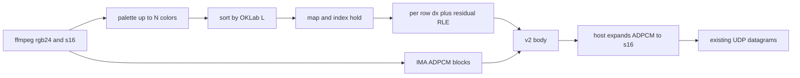

# W154 version 2 compression

Version 2 replaces version 1. Old `.w154` files are reconverted. Firmware, the VLC plugin, and the converter all speak v2 only.

Measured baselines:

- [gatorade-yunglean.mp4](f:\Downloads\gatorade-yunglean.mp4) is 8.5 MB. The `.w154` is 202 MB, 4268 frames at 24 fps (`frame_us` 41667). Bodies average 43,277 bytes (min 12, 197 empty deltas, 767 bodies at or above 50 KB). PCM s16 at 48 kHz is 17.1 MB, 8.5% of the file. The radio average is already near 9 Mbit/s. The file is large because each dirty 8-line band is stored almost raw.
- [65495-514501835_tiny.mp4](f:\Downloads\65495-514501835_tiny.mp4) is 3.0 MB. The `.w154` is 30 MB, 600 frames at 60 fps with Floyd–Steinberg and no audio. Bodies average 49,752 bytes, none empty. Reported rate: 24.15 Mbit/s average, worst second 26.83.

UDP video and audio datagrams stay as they are. The rate check still counts expanded s16 on the air, so ADPCM cannot hide audio from the 16 Mbit/s line. Default fps stays 24. The cap becomes 80 (`frame_us` 12500). One keyframe per second, from the existing `gop` formula (80 at 80 fps).

## File layout

Header stays 32 bytes. `version` is 2. `band_rows` is 1 and `band_count_max` is 240: one record is one row of 240 indexes. `frame_us` is `12500 .. 1000000`.

Body preamble is `u16 flags`, `u16 row_count`, then 30 bytes of row mask (240 bits, bit `i` is row `i`). Palette is still 512 bytes, and only on a keyframe (`flags = 3`, all 240 rows). A delta is `flags = 0`. An empty delta is 38 bytes (34 + CRC), which becomes `MinBodyBytes`.

Row record, multiple of 4:

- `u8 codec`, `i8 dx`, `u16 comp_bytes`, `data`, zero pad
- `0` raw indexes, `comp_bytes = 240`, `dx = 0`
- `1` RLE of absolute indexes, shorter than 240, `dx = 0`
- `2` delta only: RLE of `index[x] - pred[x]` after a horizontal shift. `dx` is searched from -16 to 16. Out-of-range samples clamp to the edge pixel. Add is mod 256
- `3` keyframe only: RLE of the left-pixel delta (`out[0] = index[0]`, then `index[x] - index[x-1]`)

Anything that does not beat 240 bytes is stored raw. LZ4 leaves with v1. A raw keyframe is 34 + 512 + 240 * 244 + 4 = 59110 bytes. That replaces `MaxBodyBytes` / `ASM_BYTES` (58244) in [W154Format/Picture/PictureContract.cs](W154Format/Picture/PictureContract.cs), [firmware/w154/main/proto.h](firmware/w154/main/proto.h), and [vlc-w154/decode.h](vlc-w154/decode.h).

Audio block keeps the 16-byte preamble. `sample_format` 1 is IMA ADPCM mono. v2 rejects s16 in the file. Payload is independent 256-byte blocks when full: `i16` predictor, `u8` step index, `u8` 0, then low-nibble-first samples (505 samples per full block, header sample included). The last block is short and padded to 4. `pcm_bytes` is that payload, CRC covers it, and the decoded sample count is still the timeline formula. The standard 89-entry step table is the contract.

## Converter

[W154Convert/Picture/Quantizer.cs](W154Convert/Picture/Quantizer.cs) takes a color cap. After the palette is built, used slots are sorted by OKLab L. `contain` keeps black in slot 0. The LUT is rebuilt and the GOP is mapped with that order.

[W154Convert/Picture/IndexMap.cs](W154Convert/Picture/IndexMap.cs) then holds the previous index when that color’s OKLab error is within a margin of the best match. The first margin is about one RGB565 step. Hold applies to `none` and `ordered`. Floyd–Steinberg is unchanged on the first pass.

[W154Format/Format/W154File.cs](W154Format/Format/W154File.cs) `FrameEncoder` writes rows. For each dirty row it tries absolute RLE, left-delta RLE on keyframes, and shift-plus-residual RLE on deltas, and keeps the smallest under 240. [W154Format/Codec/BandRle.cs](W154Format/Codec/BandRle.cs) already encodes an arbitrary span; the decoder’s expected length becomes 240. [W154Format/Codec/Lz4Block.cs](W154Format/Codec/Lz4Block.cs) and codec 2-as-LZ4 go away.

If the worst second is above 16 Mbit/s, [W154Convert/Convert/Converter.cs](W154Convert/Convert/Converter.cs) re-runs ffmpeg and encodes again: wider hold margins, then color caps 128, 64, and 32. It stops when the second fits or the floor is hit. The floor still writes the file and exits 2 unless `--allow-over-budget`. Each pass is one line in the log. `--fps` accepts 1..80 in [W154Convert/Program.cs](W154Convert/Program.cs).

Fitted s16 from ffmpeg is encoded to IMA before the audio block. [W154Format/Format/RateCheck.cs](W154Format/Format/RateCheck.cs) keeps using `sample_count * 2` for the air rate.

## Host, panel, VLC

[W154Format/Format/W154Movie.cs](W154Format/Format/W154Movie.cs) still maps the file. [W154Stream/Pump.cs](W154Stream/Pump.cs) decodes the IMA block that contains `_audioSample` into the existing s16 datagram. It does not send the stored nibbles. A new `ImaAdpcm` helper in `W154Format` is the only decoder on the host.

[firmware/w154/main/decode.c](firmware/w154/main/decode.c) applies row records onto the index frame and sets one bit per dirty row. No LZ4, no ADPCM. [firmware/w154/main/present.c](firmware/w154/main/present.c) ships consecutive dirty rows in runs of at most 8, which is the bounce it already has. Rows 0..15 stay on the glass when the fps digits are drawn, as bands 0 and 1 do today. `frame_us` below 12500 is rejected in `player_on_reset` and in `buffer_goal`. The 3-second preroll is capped by how many max-size bodies fit in the ring (`cap / ASM_BYTES`, and `RING_SLOTS` minus the existing margin). At 80 fps that is about 1.7 s, not 240 frames, so a fat stream cannot wait for a goal the ring will never hold. The scratch carve in [firmware/w154/main/main.c](firmware/w154/main/main.c) uses the new `ASM_BYTES`.

[vlc-w154/decode.c](vlc-w154/decode.c) and [vlc-w154/demux.c](vlc-w154/demux.c) decode rows and IMA the same way. The plugin’s audio output stays s16.

## Docs and rules

Rewrite the contract in [docs/formato-w154.md](docs/formato-w154.md) and the matching parts of [docs/conversor-w154.md](docs/conversor-w154.md), [docs/firmware-w154.md](docs/firmware-w154.md), and [docs/api-w154.md](docs/api-w154.md). Update [.cursor/rules/w154-format.mdc](.cursor/rules/w154-format.mdc), [w154-converter.mdc](.cursor/rules/w154-converter.mdc), [w154-firmware.mdc](.cursor/rules/w154-firmware.mdc), and [w154-api.mdc](.cursor/rules/w154-api.mdc). The API rule keeps the datagrams, and gains one line: the host expands ADPCM before the audio socket.

## Tests

Selftests in `W154Convert`, `W154Stream`, and `vlc-w154/decode_test.c` move to v2 vectors: empty-delta CRC, a flat row RLE, a shifted row that beats raw, hold that keeps a one-step flicker and releases a real change, IMA silence roundtrip, `frame_us` 12500 accepted and 12499 refused, s16 `sample_format` refused. Stream selftest checks that the datagram payload is s16, not nibbles.

After `dotnet build` and the selftests, reconvert both download clips with dither `none` and compare average and worst-second Mbit/s, body average, and file size against the numbers above. The tiny clip is the one that has to come down through 16 Mbit/s or hit the color floor and exit 2.